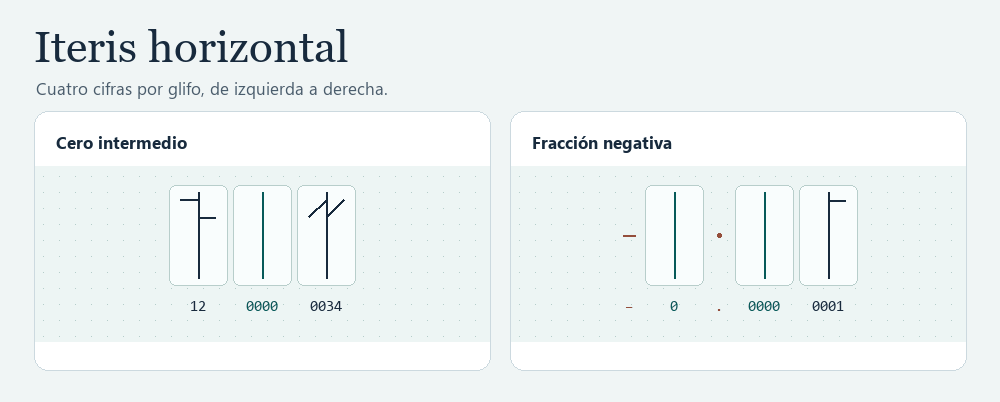
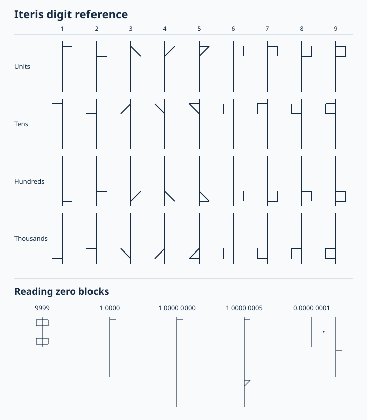

[](https://doi.org/10.5281/zenodo.24569612)

# Iteris

Iteris extends a vertical form of Cistercian numerals into a spatial notation for signed decimals. Each node encodes four decimal positions. A radix point separates the integer and fractional nodes, and the horizontal prototype uses an overbar for repeating blocks.

**Status** · Work in progress. Core v1.0 is a draft.  
**Author** · Patricio M. Vera, simbionte.org

## Cistercian origins

Cistercian numerals are documented in medieval manuscripts by the late thirteenth century. Scribes used them for folio numbers, indexes, and subdivisions of texts. In the notation described here, one compound glyph encodes any positive integer from 1 to 9,999 by placing strokes for units, tens, hundreds, and thousands around a shared stem. Historical forms varied in how they drew the strokes and placed the digits, and used both horizontal and vertical stems. [Miller's historical survey](https://www.unicode.org/L2/L2020/20290-cistercian-digits.pdf) · [MathWorld's geometric reference](https://mathworld.wolfram.com/CistercianNumerals.html)

David A. King documents the manuscripts, instruments, and later uses of the notation in *The Ciphers of the Monks: A Forgotten Number-Notation of the Middle Ages* (Franz Steiner, 2001). The earlier Cistercian demo includes a converter and an interactive glyph reference. [King's book in the BnF catalogue](https://catalogue.bnf.fr/ark:/12148/cb39031496f) · [Cistercian demo repository](https://github.com/patriciomvera/Cistercian)

## Where Iteris is going

1. **Specify the positional core.** Define how a base-10,000 chain records sign, zero blocks, and finite fractions. The Python codec and SVG renderer provide executable examples. [Core v1.0 draft](docs/ITERIS_CORE_v1.0.md)
2. **Test how people read it.** Compare exact transcription and reading time with decimal digits grouped in fours, especially when blank segments carry place value. [Reference chart](docs/assets/iteris_reference.svg)
3. **Explore other interpretations.** Give recursive expressions explicit syntax and test whether radial layouts preserve node order. The work on modular parity, qudit phase, and circuit depth has its own open questions and experiments. [Review of Gemini's proposals](docs/ITERIS_REVIEW.md)

Earlier specifications record how the design developed. [Notation v0.2](docs/history/ITERIS_NOTATION_02.md) · [Exploratory specification v0.5](docs/history/ITERIS_SPEC_v05.md) · [Specification archive](docs/history/)

## Horizontal writing demo

Download the demo file and open it in a browser. It draws the same Core glyphs in a left-to-right row with decimal digits grouped in fours below. For a recurring decimal, enter a period in parentheses, as in `0.1(6)`. A bar marks the repeating blocks. The page works offline and includes signed fractions, zero blocks, and examples with up to 64 digits. [Self-contained demo](demo/index.html)



## Run the reference implementation

From the repository root, use Python 3.9 or later. The reference implementation uses the standard library. [Python package](iteris/) · [Tests](tests/)

```sh
python -m unittest discover -v
python -m iteris.svg --horizontal 100000005 > numeral.svg
python -m iteris.svg --reference > docs/assets/iteris_reference.svg
```

```python
from iteris import decode_iteris, encode_iteris

number = encode_iteris("0.00000001")
assert [node.value for node in number.frac_nodes] == [0, 1]
assert decode_iteris(number) == "0.00000001"
```

When the glyph or layout rules change, regenerate the reference SVG and run the tests. The suite compares the checked-in chart with the renderer output. [Reference layout](docs/ITERIS_CORE_v1.0.md#horizontal-reference-layout)



## How to cite

Vera, P. M. (2026). *Rational Numerals and Carry Geometry in Iteris*. Zenodo.
https://doi.org/10.5281/zenodo.24569612 · Also on Hexagon: hexagon:2611.01089v1

GitHub's "Cite this repository" button gives the same reference in APA and BibTeX.
